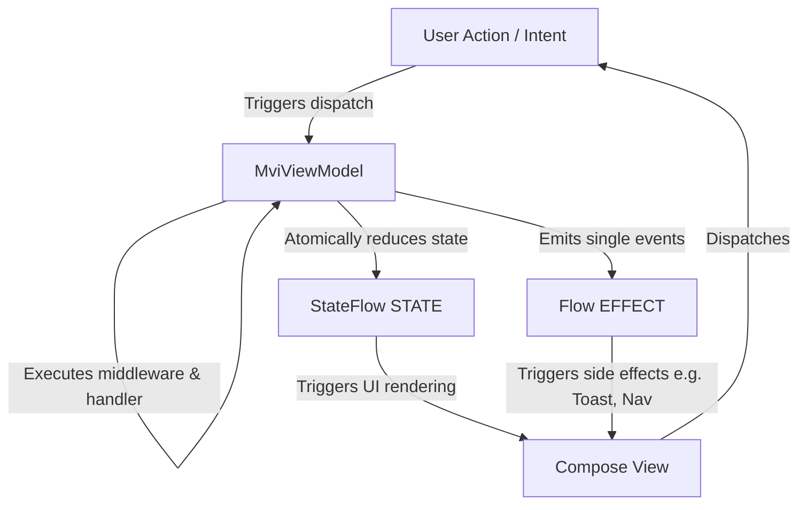

# MVIKit Architecture Documentation

This document describes the architectural design of **MVIKit**, a lightweight, robust Model-View-Intent (MVI) framework for Android application development.

---

## 1. Architectural Patterns

MVIKit is built upon the classic **Model-View-Intent (MVI)** architectural pattern, which enforces a **Unidirectional Data Flow (UDF)**. 



### Unidirectional Data Flow (UDF)
1. **User Action / Intent**: The user interacts with the UI (e.g., clicking a button). This dispatches a strongly typed `Intent` to the ViewModel.
2. **ViewModel Business Logic**: The ViewModel processes the intent by routing it through a middleware pipeline and executing its registered suspending handler.
3. **State Reduction**: The ViewModel updates the state using `reduce {}` inside the intent handler.
4. **UI Updates**: The UI observes the immutable state and updates itself accordingly.
5. **Side Effects**: One-time events (e.g., Toast, Dialogs, Navigation) are sent via `effect` and collected exactly once.

---

## 2. Core Concepts & Thread Safety

### Stateful Design (State)
* **Single Source of Truth**: The ViewModel maintains a single, immutable state container: `StateFlow<STATE>`.
* **State Reduction**: The `reduce()` API takes a block (`STATE.() -> STATE`) and applies it to the current state.
* **Thread-Safety**: State updates use `MutableStateFlow.update`, which is a non-blocking compare-and-swap loop. This ensures that even if `reduce` is called simultaneously from multiple background threads, state updates remain atomic and thread-safe.

### One-Time Event Plumbing (Side Effects)
* Standard Android architectures struggle with one-time side effects (e.g. Navigation, Snackbars, Toasts). Replaying side-effects on configuration changes causes unwanted duplicate notifications.
* **MVIKit Solution**: Exposes a `Flow<EFFECT>` backed by an internal Kotlin `Channel<EFFECT>(Channel.BUFFERED)`.
  * **No Replay**: Channels distribute elements to a single collector and do not store a replay cache. Once received, the item is cleared.
  * **Survive Collector Restarts**: Since the channel is buffered, events sent when the view is detached (or during a configuration change transition) remain in the buffer until the view binds back and resumes collection.
  * **Single Emission**: Exactly one collector consumes each effect, preventing duplicate event execution.

### Structured Concurrency & Coroutines
* `launchIntent` executes asynchronous work in the `viewModelScope`.
* **SupervisorJob Integration**: Because `viewModelScope` uses `SupervisorJob` by default under the hood, if one launched intent fails (e.g. throws a network exception), it does not cancel the parent scope or other sibling intents.
* **Uncaught Exception Routing**: An internal `CoroutineExceptionHandler` intercepts uncaught exceptions within `launchIntent` blocks, routing them directly to `onError(throwable)`. This provides a global error handling boundary for the ViewModel.

---

## 3. Strongly Typed Intent System (Phase 2)

Phase 2 introduces a strongly typed, declarative intent system that separates user action descriptions from implementation details.

### Intent Marker
The framework defines a lightweight marker interface `io.mvikit.core.intent.Intent`. All user actions must implement this marker:
```kotlin
sealed interface CounterIntent : Intent {
    data object Increment : CounterIntent
    data class ShowToast(val message: String) : CounterIntent
}
```

### Type-Safe IntentRegistry
* ViewModels manage action routing via an internal `IntentRegistry`.
* Handlers are registered using Kotlin's compile-time reified generics: `intent<I> { ... }`.
* The registry uses the `KClass` of the intent type (e.g., `I::class`) to map intents directly to handlers at **O(1)** complexity. It avoids using heavy reflection libraries (`kotlin-reflect`), keeping the runtime extremely lightweight.
* To ensure architecture stability and prevent silent bugs, the registry validates and throws an `IllegalArgumentException` immediately if duplicate handlers are registered for the same intent class.

---

## 4. Interceptor Middleware Pipeline

All dispatched intents go through an interceptor middleware chain before running their target handlers. This is modeled after the Redux/OkHttp interceptor design:

```kotlin
interface IntentMiddleware {
    suspend fun intercept(
        intent: Intent,
        next: suspend () -> Unit
    )
}
```

* **Middlewares Chain**: Each middleware can run custom code before and after calling `next()`, which continues execution to the next middleware or the final handler. A middleware can also halt the entire execution chain simply by not calling `next()`.
* **Logging Middleware**: The built-in `LoggingMiddleware` tracks received intents, execution times, and failures. It features a safe console fallback logger to run seamlessly inside local JVM unit tests without throwing Android stub exceptions.

---

## 5. Diagnostic Observers

Global monitoring and metrics collection is supported via the `IntentObserver` contract:
```kotlin
interface IntentObserver {
    fun onIntentReceived(intent: Intent)
    fun onIntentCompleted(intent: Intent)
    fun onIntentFailed(intent: Intent, throwable: Throwable)
}
```
Observers are registered globally at `MviKitDiagnostics.addObserver()`. Each dispatch event notifies observers on reception, successful completion, or failure, enabling easy integration with analytics, crash reporting tools, or custom debugger monitors.

---

## 6. Jetpack Compose Integration

MVIKit provides lifecycle-aware Compose bindings to ensure optimal performance and resources safety:

* `collectState(StateFlow)`: Automatically gathers StateFlow emissions using `collectAsStateWithLifecycle()`. This stops flow collection when the Composable is invisible (e.g., app in background), conserving CPU and battery life.
* `CollectEffects(Flow, (EFFECT) -> Unit)`: Collections are scoped to a `LaunchedEffect` and use `repeatOnLifecycle(Lifecycle.State.STARTED)` under the hood. It ensures side-effects are only processed when the UI is actively in the foreground, avoiding background action execution or state leaks.
* `MviViewModel.dispatchIntent(Intent)`: A Composable-friendly extension function allowing clean intent dispatching from Compose event handlers.

---

## 7. Phase 1 to Phase 2 Migration Guide

Upgrading a codebase from Phase 1 to Phase 2 of MVIKit is straightforward and preserves state/effect signatures.

### Step 1: Define Intent Contracts
Create an `Intent` class or sealed interface for all actions on a screen:
```kotlin
// Phase 2
sealed interface CounterIntent : Intent {
    data object Increment : CounterIntent
    data object Decrement : CounterIntent
}
```

### Step 2: Update the ViewModel
1. Remove explicit public functions representing actions.
2. Register handlers for each intent inside the `init` block using `intent<I> { ... }`:
```kotlin
// Phase 1 ViewModel
class CounterViewModel : MviViewModel<CounterState, CounterEffect>(...) {
    fun increment() {
        reduce { copy(count = count + 1) }
    }
}

// Phase 2 ViewModel
class CounterViewModel : MviViewModel<CounterState, CounterEffect>(...) {
    init {
        intent<CounterIntent.Increment> {
            reduce { copy(count = count + 1) }
        }
    }
}
```

### Step 3: Update Compose Views
Replace direct ViewModel function calls in click listeners with `dispatch(intent)` or `dispatchIntent(intent)`:
```kotlin
// Phase 1 View
Button(onClick = { viewModel.increment() }) { ... }

// Phase 2 View
Button(onClick = { viewModel.dispatch(CounterIntent.Increment) }) { ... }
```
