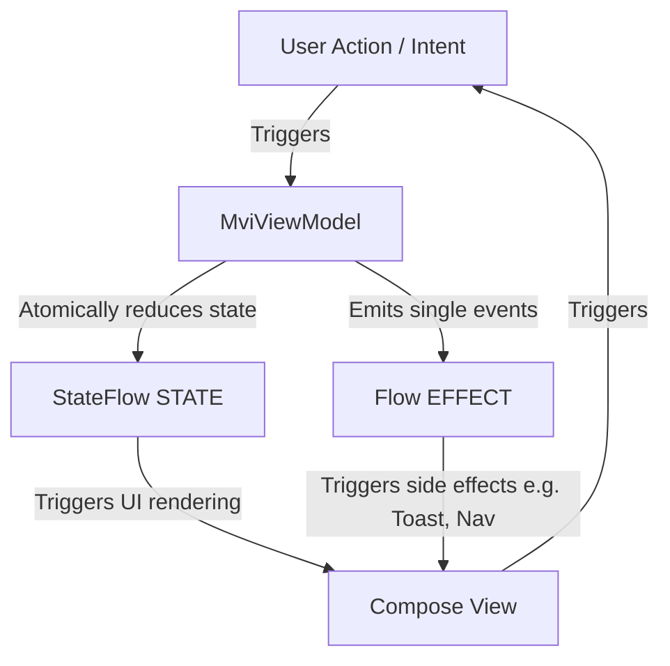

# MVIKit Architecture Documentation

This document describes the architectural design of **MVIKit**, a lightweight, robust Model-View-Intent (MVI) framework for Android application development.

---

## 1. Architectural Patterns

MVIKit is built upon the classic **Model-View-Intent (MVI)** architectural pattern, which enforces a **Unidirectional Data Flow (UDF)**. 

### Unidirectional Data Flow (UDF)
1. **User Action / Intent**: The user interacts with the UI (e.g., clicking a button). This calls a function on the ViewModel.
2. **ViewModel Business Logic**: The ViewModel executes business logic (using `launchIntent` for coroutines).
3. **State Reduction**: The ViewModel updates the state using `reduce {}`.
4. **UI Updates**: The UI observes the immutable state and updates itself accordingly.
5. **Side Effects**: One-time events (e.g., Toast, Dialogs, Navigation) are sent via `effect` and collected exactly once.

---

## 2. Core Concepts & Thread Safety

### Stateful Design (State)
* **Single Source of Truth**: The ViewModel maintains a single, immutable state container: `StateFlow<STATE>`.
* **State Reduction**: The `reduce()` API takes a block (`STATE.() -> STATE`) and applies it to the current state.
* **Thread-Safety**: State updates use `MutableStateFlow.update`, which is a non-blocking compare-and-swap loop. This ensures that even if `reduce` is called simultaneously from multiple background threads, state updates remain atomic and thread-safe.

### One-Time Event Plumbing (Side Effects)
* Standard Android architectures struggle with one-time side effects (e.g. Navigation, Snackbars, Toasts). Replaying side-effects on configuration changes causes unwanted duplicate notifications.
* **MVIKit Solution**: Exposes a `Flow<EFFECT>` backed by an internal Kotlin `Channel<EFFECT>(Channel.BUFFERED)`.
  * **No Replay**: Channels distribute elements to a single collector and do not store a replay cache. Once received, the item is cleared.
  * **Survive Collector Restarts**: Since the channel is buffered, events sent when the view is detached (or during a configuration change transition) remain in the buffer until the view binds back and resumes collection.
  * **Single Emission**: Exactly one collector consumes each effect, preventing duplicate event execution.

### Structured Concurrency & Coroutines
* `launchIntent` executes asynchronous work in the `viewModelScope`.
* **SupervisorJob Integration**: Because `viewModelScope` uses `SupervisorJob` by default under the hood, if one launched intent fails (e.g. throws a network exception), it does not cancel the parent scope or other sibling intents.
* **Uncaught Exception Routing**: An internal `CoroutineExceptionHandler` intercepts uncaught exceptions within `launchIntent` blocks, routing them directly to `onError(throwable)`. This provides a global error handling boundary for the ViewModel.

---

## 3. Jetpack Compose Integration

MVIKit provides lifecycle-aware Compose bindings to ensure optimal performance and resources safety:

* `collectState(StateFlow)`: Automatically gathers StateFlow emissions using `collectAsStateWithLifecycle()`. This stops flow collection when the Composable is invisible (e.g., app in background), conserving CPU and battery life.
* `CollectEffects(Flow, (EFFECT) -> Unit)`: Collections are scoped to a `LaunchedEffect` and use `repeatOnLifecycle(Lifecycle.State.STARTED)` under the hood. It ensures side-effects are only processed when the UI is actively in the foreground, avoiding background action execution or state leaks.

---

## 4. Future Extensibility

MVIKit's design is deliberately simplified to provide a solid foundation for future additions:
* **KSP & Code Generation**: Can be introduced later to automatically generate Intent wrappers or compile-safe state copy mechanisms.
* **Navigation Integration**: A separate `mvikit-navigation` module can wrap navigation routes into a dedicated side-effect handler.
* **Form Validation**: Form state components can easily extend standard state models, using custom reducers to apply validation rules without changing the core framework.
