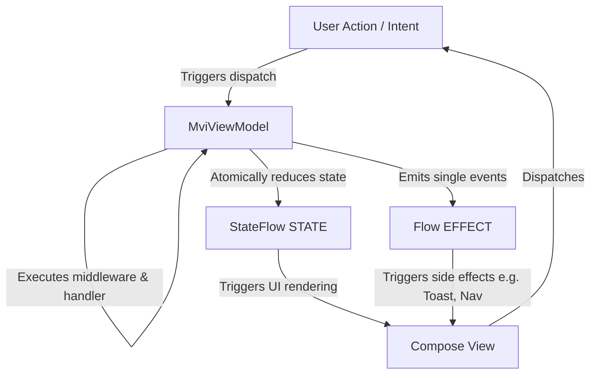

# MVIKit Architecture Documentation

This document describes the architectural design of **MVIKit**, a lightweight, robust Model-View-Intent (MVI) framework for Android application development.

---

## 1. Architectural Patterns

MVIKit is built upon the classic **Model-View-Intent (MVI)** architectural pattern, which enforces a **Unidirectional Data Flow (UDF)**. 



### Unidirectional Data Flow (UDF)
1. **User Action / Intent**: The user interacts with the UI (e.g., clicking a button). This dispatches a strongly typed `Intent` to the ViewModel.
2. **ViewModel Business Logic**: The ViewModel processes the intent by routing it through a middleware pipeline and executing its registered suspending handler.
3. **State Reduction**: The ViewModel updates the state using `reduce {}` inside the intent handler.
4. **UI Updates**: The UI observes the immutable state and updates itself accordingly.
5. **Side Effects**: One-time events (e.g., Toast, Dialogs, Navigation) are sent via `effect` and collected exactly once.

---

## 2. Core Concepts & Thread Safety

### Stateful Design (State)
* **Single Source of Truth**: The ViewModel maintains a single, immutable state container: `StateFlow<STATE>`.
* **State Reduction**: The `reduce()` API takes a block (`STATE.() -> STATE`) and applies it to the current state.
* **Thread-Safety**: State updates use `MutableStateFlow.update`, which is a non-blocking compare-and-swap loop. This ensures that even if `reduce` is called simultaneously from multiple background threads, state updates remain atomic and thread-safe.

### One-Time Event Plumbing (Side Effects)
* Standard Android architectures struggle with one-time side effects (e.g. Navigation, Snackbars, Toasts). Replaying side-effects on configuration changes causes unwanted duplicate notifications.
* **MVIKit Solution**: Exposes a `Flow<EFFECT>` backed by an internal Kotlin `Channel<EFFECT>(Channel.BUFFERED)`.
  * **No Replay**: Channels distribute elements to a single collector and do not store a replay cache. Once received, the item is cleared.
  * **Survive Collector Restarts**: Since the channel is buffered, events sent when the view is detached (or during a configuration change transition) remain in the buffer until the view binds back and resumes collection.
  * **Single Emission**: Exactly one collector consumes each effect, preventing duplicate event execution.

### Structured Concurrency & Coroutines
* `launchIntent` executes asynchronous work in the [viewModelScope](file:///Users/sanjays/Documents/vibecode/MVIKit/mvikit-core/src/main/java/com/developersyndicate/mvikit/core/ViewModel.kt).
* **SupervisorJob Integration**: Because `viewModelScope` uses `SupervisorJob` by default under the hood, if one launched intent fails (e.g. throws a network exception), it does not cancel the parent scope or other sibling intents.
* **Uncaught Exception Routing**: An internal `CoroutineExceptionHandler` intercepts uncaught exceptions within `launchIntent` blocks, routing them directly to `onError(throwable)`. This provides a global error handling boundary for the ViewModel.

---

## 3. Strongly Typed Intent System (Phase 2)

Phase 2 introduces a strongly typed, declarative intent system that separates user action descriptions from implementation details.

### Intent Marker
The framework defines a lightweight marker interface `com.developersyndicate.mvikit.core.intent.Intent`. All user actions must implement this marker:
```kotlin
sealed interface CounterIntent : Intent {
    data object Increment : CounterIntent
    data class ShowToast(val message: String) : CounterIntent
}
```

### Type-Safe IntentRegistry
* ViewModels manage action routing via an internal `IntentRegistry`.
* Handlers are registered using Kotlin's compile-time reified generics: `intent<I> { ... }`.
* The registry uses the `KClass` of the intent type (e.g., `I::class`) to map intents directly to handlers at **O(1)** complexity. It avoids using heavy reflection libraries (`kotlin-reflect`), keeping the runtime extremely lightweight.
* To ensure architecture stability and prevent silent bugs, the registry validates and throws an `IllegalArgumentException` immediately if duplicate handlers are registered for the same intent class.

---

## 4. Interceptor Middleware Pipeline

All dispatched intents go through an interceptor middleware chain before running their target handlers. This is modeled after the Redux/OkHttp interceptor design:

```kotlin
interface IntentMiddleware {
    suspend fun intercept(
        intent: Intent,
        next: suspend () -> Unit
    )
}
```

* **Middlewares Chain**: Each middleware can run custom code before and after calling `next()`, which continues execution to the next middleware or the final handler. A middleware can also halt the entire execution chain simply by not calling `next()`.
* **Logging Middleware**: The built-in `LoggingMiddleware` tracks received intents, execution times, and failures. It features a safe console fallback logger to run seamlessly inside local JVM unit tests without throwing Android stub exceptions.

---

## 5. Diagnostic Observers

Global monitoring and metrics collection is supported via the `IntentObserver` contract:
```kotlin
interface IntentObserver {
    fun onIntentReceived(intent: Intent)
    fun onIntentCompleted(intent: Intent)
    fun onIntentFailed(intent: Intent, throwable: Throwable)
}
```
Observers are registered globally at `MviKitDiagnostics.addObserver()`. Each dispatch event notifies observers on reception, successful completion, or failure, enabling easy integration with analytics, crash reporting tools, or custom debugger monitors.

---

## 6. Async Actions Execution Engine (Phase 3)

Phase 3 introduces first-class **Asynchronous Action Execution** (`execute`) designed to eliminate boilerplate surrounding network requests, operations state tracking, and error handling pipelines.

```kotlin
protected fun <T> execute(
    key: String = java.util.UUID.randomUUID().toString(),
    request: suspend () -> T,
    onSuccess: suspend (T) -> Unit,
    onFailure: (suspend (Throwable) -> Unit)? = null,
    onFinally: (suspend () -> Unit)? = null,
    policy: DuplicateActionPolicy = DuplicateActionPolicy.ALLOW,
    retries: Int = 0,
    retryDelayMillis: Long = 0,
    exponentialBackoff: Boolean = false,
    loadingKey: String? = null
)
```

### Key Execution Capabilities
* **Automatic Loading State**: Active actions are automatically tracked by key in `actionState`. This can be observed from the UI using the Compose `viewModel.rememberActionState("key")` helper.
* **Error Pipeline**: Handled errors are directed to `onFailure`. Unhandled errors (when `onFailure` is omitted) route directly to the ViewModel's global `onError()`.
* **Retry Engine**: Retries only occur on failure, utilizing configurable initial delays and optional exponential backoffs (e.g. 1s -> 2s -> 4s). It preserves standard coroutines cancellation semantics.
* **Duplicate Action Policies**: Defines the strategy when duplicate execution requests are triggered for the same key:
  - `ALLOW`: Runs concurrently.
  - `IGNORE`: Ignores the new request if the previous one is still executing.
  - `CANCEL_PREVIOUS`: Cancels and waits for the previous job to finish cleaning up before starting.
  - `RESTART`: Cancels the previous job immediately and starts the new one.
* **Cancellation**: Individual actions can be terminated immediately using `cancelAction(key)`, and all active processes can be aborted via `cancelAllActions()`.

---

## 7. State Transactions (Phase 3)

In standard MVI, triggering multiple sequential reductions emits multiple intermediate states, causing duplicate recompositions. MVIKit introduces atomic **State Transactions**:

```kotlin
transaction {
    update { copy(isLoading = true) }
    update { copy(errorMessage = null) }
}
```

* **Batching**: Updates run sequentially on an intermediate `TransactionScope`.
* **Single Emission**: The final state is applied back to the `StateFlow` exactly once, guaranteeing atomic updates and preventing intermediate recompositions in Compose.

---

## 8. Diagnostics Action Observers (Phase 3)

Similar to intent observers, asynchronous action lifecycles can be monitored globally:
```kotlin
interface ActionObserver {
    fun onStarted(key: String)
    fun onSuccess(key: String)
    fun onFailure(key: String, throwable: Throwable)
    fun onCancelled(key: String)
}
```
Register observers at `MviKitActionDiagnostics.addObserver()` to capture start, success, failure, and cancellation telemetry.

---

## 9. Phase 2 to Phase 3 Migration Guide

Upgrading to Phase 3 introduces helper APIs that replace boilerplate loading variables and error loops.

### Step 1: Migrate Loading State & Asynchronous Execution
Replace manual `launchIntent` blocks containing loading toggles and try-catch blocks with the `execute` API:

```kotlin
// Phase 2 (Manual)
intent<LoginIntent.Submit> {
    reduce { copy(isLoading = true) }
    launchIntent {
        try {
            val result = api.login(...)
            effect(Success(result))
        } catch (t: Throwable) {
            onError(t)
        } finally {
            reduce { copy(isLoading = false) }
        }
    }
}

// Phase 3 (Automated)
intent<LoginIntent.Submit> {
    execute(
        key = "login",
        request = { api.login(...) },
        onSuccess = { result -> effect(Success(result)) }
    )
}
```
*Observe the loading state in Compose UI directly using `val isLoggingIn = viewModel.rememberActionState("login")`.*

### Step 2: Batch Sequential Reductions
Group sequential `reduce` calls into a single `transaction` block to guarantee atomic updates and optimize recomposition cycles:

```kotlin
// Phase 2
reduce { copy(email = "test@email.com") }
reduce { copy(errorMessage = null) }

// Phase 3
transaction {
    update { copy(email = "test@email.com") }
    update { copy(errorMessage = null) }
}
```

---

## 10. Form Engine & Validation Framework (Phase 4)

Phase 4 introduces a reflection-free, type-safe validation and form state synchronization engine. It serves as the runtime contract for future KSP code generators.

### 10.1 Key API Abstractions
* **`FormState`**: Marker interface that developers implement to define form data models.
* **`FormField<T>`**: Immutable state containing value, validation errors, touched state (focus tracking), and dirty state.
* **`BoundField<T>`**: Class returned by the form's index operator `form["email"]` that links a field back to its parent `Form` for updating.
* **`ValidationResult`**: The result of validation checks, detailing overall validity and a map of field error strings.
* **`Validator<T>`**: Generic interface contract for validators. Returns `null` if valid, or a string error message if invalid.

### 10.2 Built-in Validators
* `RequiredValidator`: Validates that a field is not null, not blank for strings, and not empty for collections or maps.
* `EmailValidator`: Validates RFC-compliant email address format.
* `PasswordValidator`: Validates password length and complex rules (uppercase, lowercase, special characters, digits).
* `MinLengthValidator` / `MaxLengthValidator`
* `RegexValidator`
* `MatchValidator`: Compares field value against a reference provider value (e.g., password matching).

### 10.3 Form Validation Modes
The validation engine supports four `ValidationMode` strategies:
1. **`ON_CHANGE`**: Validates the value and displays errors immediately as the user types.
2. **`ON_BLUR`**: Validates and displays errors only after focus is lost (marked touched).
3. **`ON_SUBMIT`**: Displays errors only during form submission.
4. **`MANUAL`**: Validation only displays errors when calling `validate()` manually.

### 10.4 Multi-Step Form Support
Multi-step checkout patterns are coordinated using `MultiStepForm`:
```kotlin
val multiForm = MultiStepForm(listOf(shippingForm, contactForm, paymentForm))
```
It isolates validation state per step, handles progress indexing, validates step-by-step navigation boundaries, and runs global validation check across all steps via `validateAll()`.

---

## 11. Compose Integration (Phase 4)

The Compose module contains bindings that eliminate layout boilerplate:

* **`rememberForm`**: Remembers form states across recompositions.
* **`bindField`**: Returns a lifecycle-aware Compose `State<FormField<T>>`.
* **`FormTextField`**: A Material3 OutlinedTextField that automates state synchronization, error display, and validation triggers.

---

## 12. Phase 3 to Phase 4 Migration Guide

Upgrading to Phase 4 replaces repetitive state definitions and validation boilerplate with the declarative DSL engine.

### Step 1: Replace Manual Form State with the Form Engine
Instead of manually declaring form field states and handling text updates in the ViewModel:

```kotlin
// Phase 3 (Manual state & validation)
data class SignUpState(
    val email: String = "",
    val emailError: String? = null
)

// Phase 4 (Declarative Form DSL)
val form = rememberForm(ValidationMode.ON_CHANGE) {
    field("email") {
        required("Email is required")
        email("Invalid email format")
    }
}
```

### Step 2: Use Automated FormTextField Bindings
Replace standard `OutlinedTextField` implementations with `FormTextField` which automatically binds value updates and error displays:

```kotlin
// Phase 3
OutlinedTextField(
    value = state.email,
    onValueChange = { onEmailChange(it) },
    isError = state.emailError != null,
    supportingText = { state.emailError?.let { Text(it) } }
)

// Phase 4
FormTextField(
    field = form["email"],
    label = { Text("Email") }
)
```

---

## 13. Navigation & Side Effects Engine (Phase 5)

Phase 5 introduces a type-safe, platform-agnostic navigation backstack and standardized side-effects execution system. It eliminates custom ViewModel side-effect class declarations.

### 13.1 Screen Routing Contracts
* **`Screen`**: Marker interface that route definitions implement. Screens can be `object`s (for static routes) or `data class`es (for parametrized routes).
* **`ScreenResult`**: Marker interface for payload values returned when screens are popped.

### 13.2 Unified UI Effects
Custom side-effect sealed classes are replaced by the standardized `UiEffect` hierarchy:
- `Toast(message, durationLong)`: Pops standard toast alerts.
- `Snackbar(message, actionLabel)`: Pops snackbar alerts.
- `Dialog(title, message, deferred)`: Suspends until the user confirms or cancels an AlertDialog.
- `BottomSheet(sheetScreen, deferred)`: Suspends until a ModalBottomSheet finishes returning a result.
- `Permission(permissions, deferred)`: Suspends until standard Android runtime permissions are resolved.

### 13.3 Suspend-Based APIs
The `Navigator` exposes coroutine-friendly suspending signatures that resolve values asynchronously without registering complex Activity contracts:
- `val result = navigator.navigateForResult<MyResult>(MyScreen)`
- `val confirmed = navigator.showConfirmationDialog(title, message)`
- `val granted = navigator.requestPermission(CAMERA)`

---

## 14. Compose Navigation Integration (Phase 5)

We provide a custom, type-safe navigation graph builder and Composable host:

* **`navigationGraph`**: DSL to register screen class matches:
  ```kotlin
  val graph = navigationGraph(StartScreen) {
      screen<LoginScreen> { LoginView(navigator) }
      screen<HomeScreen> { HomeView(navigator) }
  }
  ```
* **`MviKitNavigationHost`**: The container managing backstack updates, rendering Dialog overlays, presenting modal Bottom Sheets, and resolving runtime permissions via Compose Activity Result APIs.

---

## 15. Phase 4 to Phase 5 Migration Guide

Upgrading to Phase 5 removes custom side-effect subclasses and integrates a unified screen-routing pipeline.

### Step 1: Migrate Custom View Effects to Unified UiEffect Helpers
Instead of declaring custom effect sealed classes in your ViewModels:

```kotlin
// Phase 4 (Custom effect classes)
sealed interface DetailEffect {
    data class ShowToast(val text: String) : DetailEffect
    data object CloseScreen : DetailEffect
}

// Phase 5 (Unified Navigator Calls)
navigator.showToast("Success!")
navigator.pop()
```

### Step 2: Swap Compose Routing to Type-Safe Screen Graph
Replace string-based navigation routes or manual routing switches with the type-safe `MviKitNavigationHost`:

```kotlin
// Phase 4 (Manual navigation matching)
when (currentScreen) {
    "login" -> LoginScreen()
    "home" -> HomeScreen()
}

// Phase 5 (Structured Navigation Graph)
MviKitNavigationHost(
    navigator = navigator,
    graph = graph
)
```


## 16. KSP Code Generation Platform (Phase 6)

Phase 6 introduces a compile-time, annotation-driven code generation engine using Kotlin Symbol Processing (KSP). It reduces MVI boilerplate by 70-90% while keeping the system 100% reflection-free and explicit.

### 16.1 Target Annotation Engine
- **`@MviScreen(name)`**: Generates stub classes `NameState`, `NameIntent`, `NameEffect`, and `NameContract` for standard setups.
- **`@GenerateState`**: Resolves properties of an interface to generate a matching immutable state data class with type-safe default values.
- **`@MviViewModel`**: Scans ViewModels for `@IntentHandler` and `@Reducer` methods, producing extension function bindings `registerGeneratedIntents()`.
- **`@MviAction`**: Generates wrapper functions wrapping suspending methods into MVIKit's `execute(...)` queue engine.
- **Form Validators**: Translates form class annotations (`@Required`, `@Email`, `@Password`, `@MatchField`, etc.) into reflection-free validation validators classes.
- **`@Destination` / `@DeepLink` / `@ComposableScreen`**: Translates routing annotations into `registerAllGeneratedDeepLinks()` and `registerAllGeneratedScreens(navigator)` graph declarations.

### 16.2 Compile-Time Validation Checks
The processor intercepts compilation errors early by verifying:
1. **Duplicate Destinations**: Ensures class simple names are unique.
2. **Invalid MatchField**: Confirms target field names exist.
3. **Invalid Deep Links**: Verifies parameters mapped in `{userId}` match constructor parameters.
4. **Invalid Intents**: Rejects duplicate intent handler/reducer registrations.

---

## 17. Phase 5 to Phase 6 Migration Guide

Upgrading to Phase 6 replaces manual intent registration, form builder blocks, and screen mapping code with annotation processing.

### Step 1: Add KSP to Your Module
Apply the KSP plugin and add dependencies in your module's `build.gradle.kts`:
```kotlin
plugins {
    alias(libs.plugins.ksp)
}

dependencies {
    implementation(project(":mvikit-annotations"))
    ksp(project(":mvikit-ksp"))
}
```

### Step 2: Swap Manual Intent Handler Registrations
Instead of manually declaring registration blocks in your ViewModel constructor:
```kotlin
// Phase 5
init {
    intent<UpdateEmail> { handleUpdateEmail(it) }
}

// Phase 6
@com.developersyndicate.mvikit.annotations.MviViewModel
class MyViewModel : MviViewModel<...> {
    init {
        registerGeneratedIntents()
    }

    @IntentHandler
    fun handleUpdateEmail(intent: UpdateEmail) { ... }
}
```

### Step 3: Swap Navigation Graph Mapping
Replace manual screen registrations in Compose host initialization:
```kotlin
// Phase 5
val graph = navigationGraph(StartScreen) {
    screen<HomeScreen> { HomeScreenView(navigator) }
}

// Phase 6
val graph = navigationGraph(StartScreen) {
    registerAllGeneratedScreens(navigator)
}
```
*Screens are declared using `@Destination` or `@ComposableScreen(viewName = "MyScreenView")`.*


